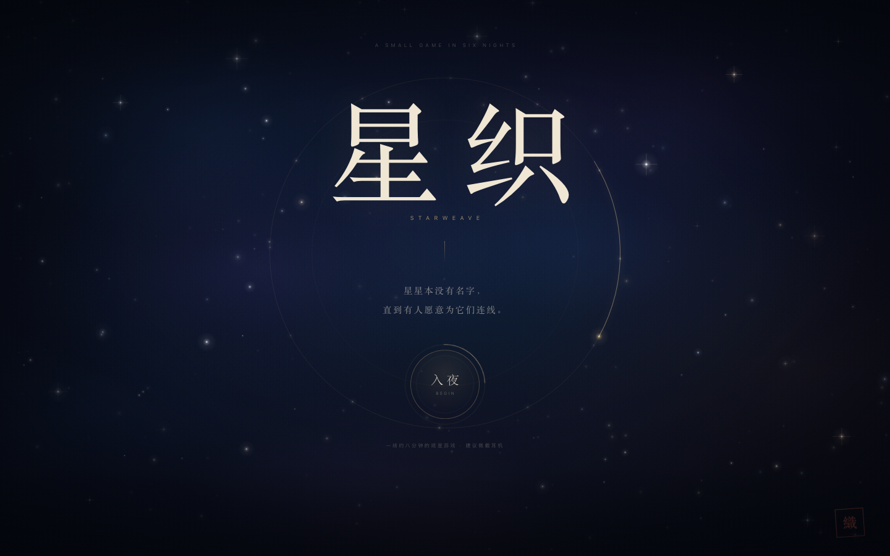
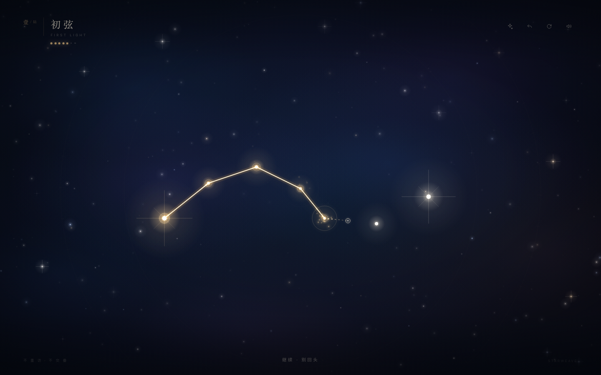
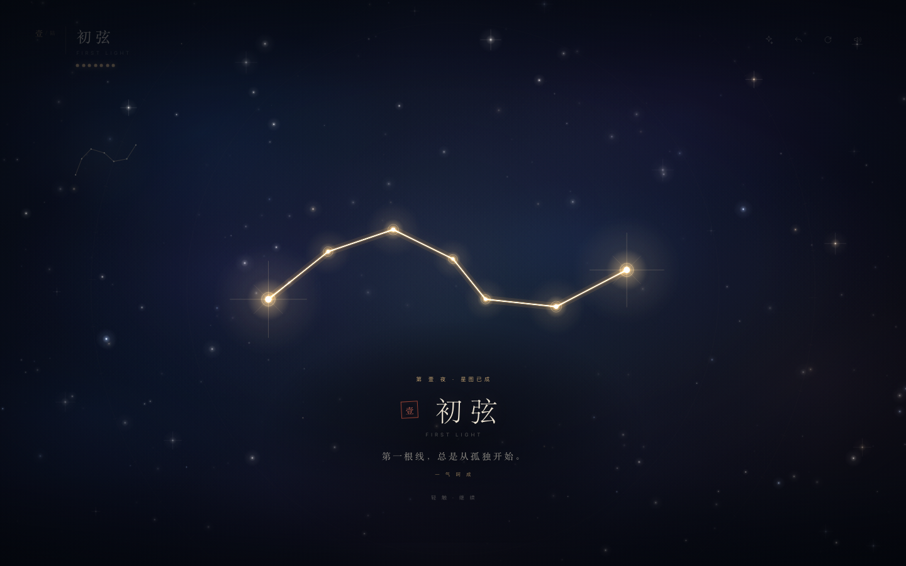
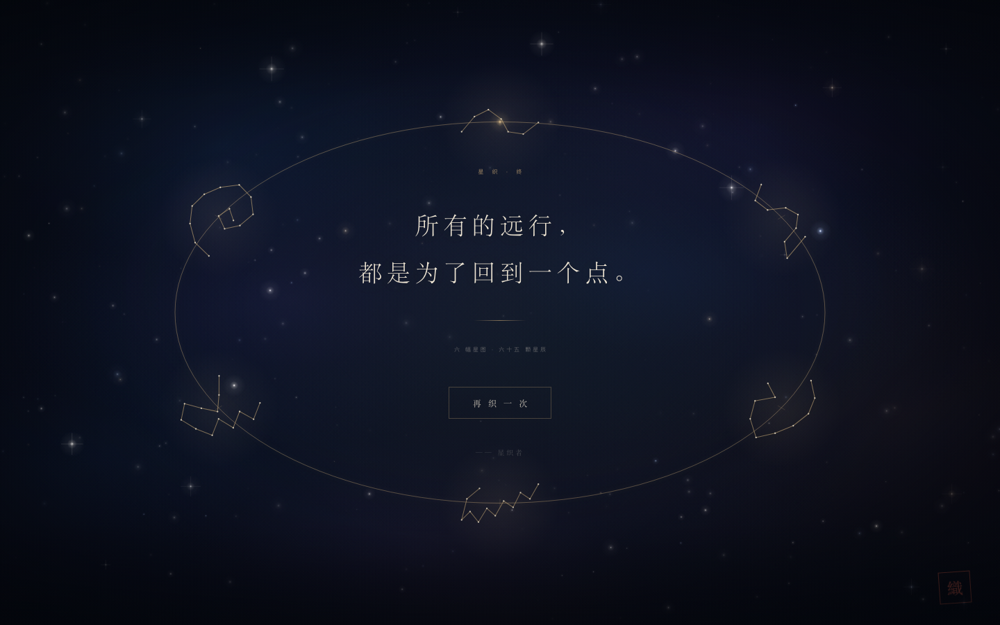

# 星织 · STARWEAVE

> 星星本没有名字，直到有人愿意为它们连线。

一场关于星辰与连线的静默小游戏。六夜，六十五颗星，一根不回头的线。

**在线试玩：[secondmax.github.io/STARWEAVE](https://secondmax.github.io/STARWEAVE/)**



## 开始

双击 `starweave.html`，用 Chrome 或 Safari 打开即可；也可以直接访问[在线试玩](https://secondmax.github.io/STARWEAVE/)。游戏本体单文件、可离线运行；页面接入 Google Analytics 4 做访问统计（统计脚本被拦截时不影响游戏）。建议佩戴耳机。

## 玩法

- 按住一颗星，拖向下一位。线会自然地被星辰吸引。
- 用一根线穿过所有星辰，这一夜便完成了。
- 线不可重访同一颗星，也不可与自己交叠。
- 完成的星图会飞入夜空；六夜之后，抬头看。

| 操作                | 说明          |
| ----------------- | ----------- |
| 拖动                | 连线          |
| `Z` / `Backspace` | 回退一步        |
| `H`               | 引路：微光提示下一颗星 |
| `R`               | 重来本夜        |
| `M`               | 开关声音        |

未使用引路、回退与重来的星图，会被记作「一气呵成」。

## 六夜

| 夜 | 星图 | 一句               |
| - | -- | ---------------- |
| 壹 | 初弦 | 第一根线，总是从孤独开始。    |
| 贰 | 潮汐 | 有些光，要等潮水退去才看得见。  |
| 叁 | 回廊 | 我们绕了很远，才回到彼此身边。  |
| 肆 | 鹿鸣 | 听，星星踩过树梢的声音。     |
| 伍 | 余烬 | 燃尽的，才配叫作光。       |
| 陆 | 归途 | 所有的远行，都是为了回到一个点。 |



## 设计手记

**一根线，不回头。** 规则只有两条：不重访、不交叠。它把「连接」变成一种有代价的动作，也让每一幅星图都像一次呼吸，而不是一次点击。完成后，玩家画下的那条线就是星座本身——游戏不评判它像不像一个既有的图案。

**星图会被收进天空。** 每一夜的成果不会消失：它缩小、飞入夜空的一角，成为下一夜的背景。六张星图最终在结局里围成一圈，连成一个更大的东西。星星的意义，是被人记住的连线。

**视觉。** 墨蓝、象牙白、旧金，一点朱砂印。大字号用宋体细体，小字用无衬线体做字距，像天文图录与旧书的混血。画布上有星云、颗粒、极淡的星盘刻度；每一颗星都有呼吸。

**声音。** 全部由 WebAudio 实时合成：低频氛围、风声、五声音阶的钟声。每一次连线都是一颗音，每完成一夜是一组和弦。没有音频文件。

**响应式。** 竖屏时整片星图会转 90°，让横向的星座在长夜里立起来；桌面端保留更宽的星空。界面、字号、安全区都随屏幕调整。

## 工程

- `starweave.html` — 最终成品，自包含（HTML + CSS + JS + 生成式音频；除 GA4 统计脚本外无外部依赖）。
- `src/shell.html` — 界面与样式。
- `src/game.js` — 游戏逻辑、渲染、音频。
- `src/build.py` — 将源文件合并为单文件成品：

```bash
python3 src/build.py
```

技术栈：原生 Canvas 2D、WebAudio、Pointer Events；无框架；游戏本体无网络请求，仅接入 GA4 统计脚本。

## 统计

页面在 `<head>` 中接入 Google Analytics 4，Measurement ID：`G-6BP0J06GF1`。

自动记录 `page_view`，并发送以下游戏事件：

- `game_start`
- `constellation_complete`（关卡、星数、是否一气呵成）
- `game_complete`（完成星图数、星辰数）
- `replay`

只发送以上事件与基础访问数据，不发送玩家的连线内容。如不需要统计，删除 `src/shell.html` 中的 gtag 代码并运行 `python3 src/build.py` 重新构建即可。

> 提示：Google Analytics 在中国大陆网络下可能无法加载，但不影响游戏运行。如需国内可用的统计，可以另外接入 Cloudflare Web Analytics、Umami 或百度统计。





---

*「所有的远行，都是为了回到一个点。」*
